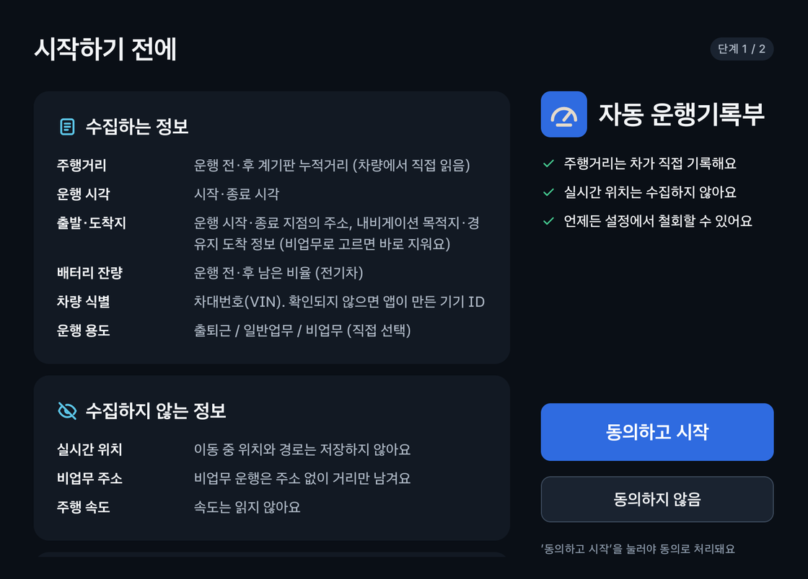
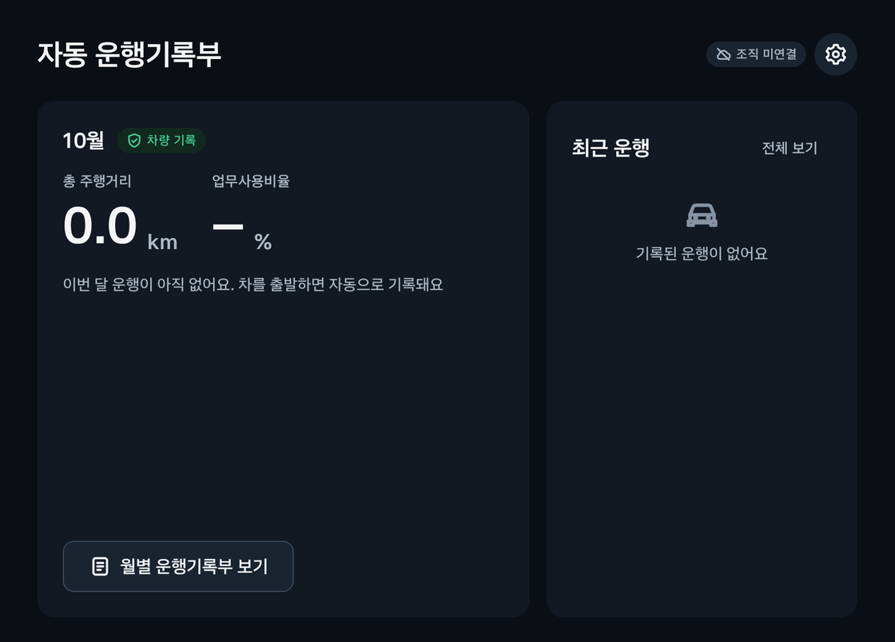
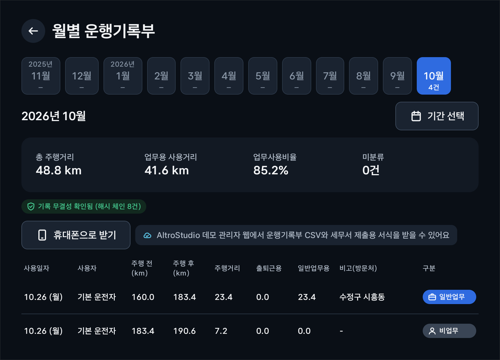
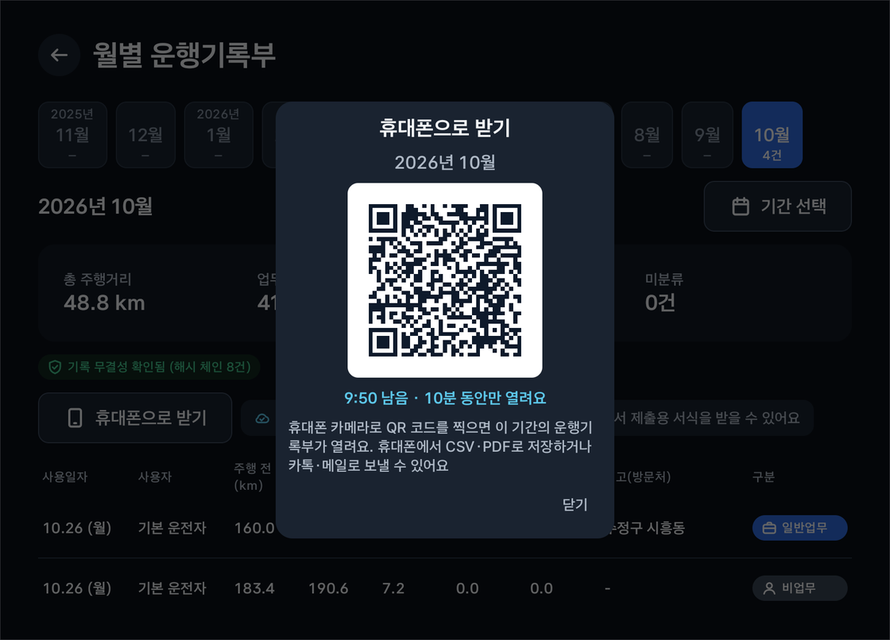
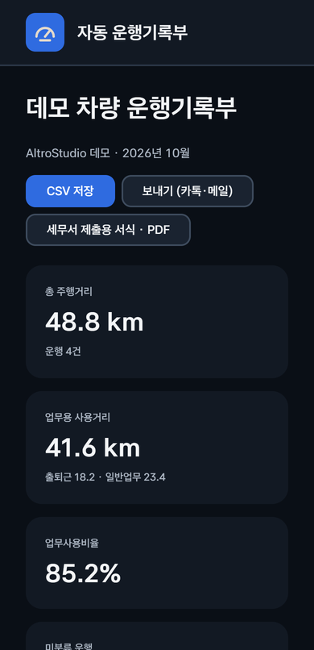
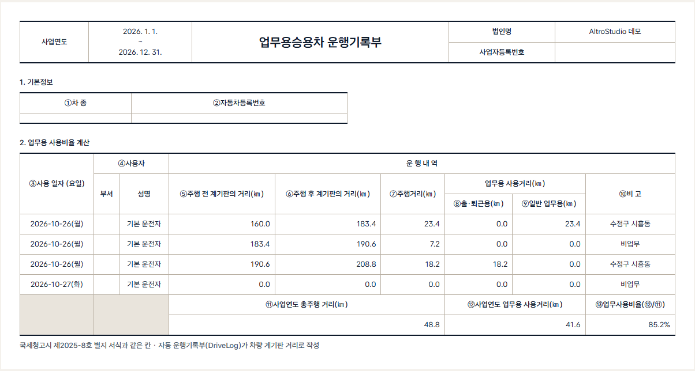

# 차곡 (Chagok) — 차가 쓰는 운행기록부

AltroStudio · 현대자동차그룹 차량용 앱 개발 공모전 출품작 (Pleos Connect 앱)

**차가 알아서 쓰는 업무용 승용차 운행기록부.** 주행 중에는 조작할 것이 없고, 정차 후 한 번 눌러 용도만 고르면 월별 운행기록부가 완성됩니다.

| 첫 실행 동의 | 차량 연결 (6자리 코드) | 홈 |
|---|---|---|
|  |  |  |

| 운행기록부 (달·기간 고르기) | 휴대폰으로 받기 (QR 코드) | 휴대폰에서 연 운행기록부 |
|---|---|---|
|  |  |  |

> **0.4.0 (2026-11-08)**: 차량 앱(자동 기록, 정차 후 분류·말로 기록, 운전자 맞춤·무드등·하차 점검, 차 상태 보기, 사용법·음성 도움 비서, 운행기록부), 서버(Supabase), 관리자 웹이 모두 동작하고, Pleos Connect 에뮬레이터와 실서버로 확인했습니다. 기능별 상태와 확인 내용은 [docs/status.md](docs/status.md), 제출 점검표는 [docs/submission-checklist.md](docs/submission-checklist.md)에 있습니다.

**시연 영상**: [docs/video/Chagok_demo_0.4.0.mp4](docs/video/Chagok_demo_0.4.0.mp4) (3분 52초, 에뮬레이터 화면 녹화 + 자막. 차가 하는 말은 자막으로 넣었습니다. 말로 기록 장면은 에뮬레이터가 사람 목소리를 들을 수 없어 녹음한 목소리 파일을 넣어 시연했습니다)

공모전 README 필수 항목: [앱 이름 및 한 줄 소개](#앱-이름-및-한-줄-소개) · [APK 파일 위치](#apk-파일-위치) · [실행 방법](#실행-방법) · [테스트 환경 및 필요한 설정](#테스트-환경-및-필요한-설정)

## 앱 이름 및 한 줄 소개

- **앱 이름**: 차곡 (Chagok) — 차가 쓰는 운행기록부. "차곡차곡 쌓이는 운행 기록"이라는 뜻 (패키지 이름은 `com.altrostudio.drivelog` 그대로)
- **한 줄 소개**: 법인·관공서의 공용차를 위한 차량용 앱. 운전자를 알아보고 그분의 온도·시트·무드등으로 차를 맞추고, 계기판 거리로 운행기록부를 차가 직접 쓰며, 정차 후 한 번 누르거나 말로 용도를 남기고, 내리기 전에는 창문과 실내등까지 정리합니다.

## APK 파일 위치

- [`apk/AltroStudio_Chagok_release.apk`](apk/AltroStudio_Chagok_release.apk) (release 서명 빌드, 0.4.0, 약 54 MB)
- 직접 만들 때: `keystore.properties.example`을 `keystore.properties`로 복사해 서명 키 정보를 넣고 `./gradlew assembleRelease` (서명 키와 `keystore.properties`는 커밋하지 않습니다)
- APK에는 서버 주소와 **공개 키(Publishable key)** 가 들어 있습니다. 공개 키는 앱에 넣도록 만들어진 키이고, 데이터 보호는 서버의 권한 규칙(RLS)이 맡습니다. 관리용 secret/service_role 키는 APK와 웹 어디에도 넣지 않습니다.

## 실행 방법

### 1. APK로 바로 해 보기 (심사용)

1. `Pleos_Connect_v2.1` 에뮬레이터를 **Cold boot**로 켜고 APK를 설치합니다: `adb install apk/AltroStudio_Chagok_release.apk`
2. 앱을 열고 동의합니다. **계정이나 로그인 없이** 바로 기록이 켜집니다.
3. 연결 화면에서 시연용 코드 `422511`을 넣으면 데모 조직에 연결됩니다. [나중에 연결]을 누르면 이 차량 안에서만 기록합니다.
4. Virtual Console에서 기어를 **D**로 바꾸고 계기판 거리를 늘린 뒤 **P**로 바꾸면 분류 화면이 뜨고, 차가 "용도와 업무 내용을 말씀해 주세요"라고 묻습니다. 용도를 한 번 누르면 운행기록부에 들어갑니다. 말로 해 보려면 에뮬레이터의 PC 마이크를 켜고(아래 [말로 기록 시험](#말로-기록-시험)) "업무, 거래처 미팅"이라고 답한 뒤, 차가 되읽으면 "맞아"라고 하거나 [맞아요]를 누릅니다. [직접 입력]으로 적어도 됩니다.
5. 홈의 [월별 운행기록부 보기]에서 달 칩이나 [기간 선택](달력)으로 기간을 고르고, [휴대폰으로 받기]의 QR 코드를 휴대폰 카메라로 찍으면 휴대폰에서 운행기록부가 열립니다(조직에 연결한 경우).
6. 관리자 웹 https://altrostudio-drivelog.vercel.app/app.html 에 기업 계정으로 로그인하면 같은 기록과 **세무 제출** 탭(국세청 서식 인쇄·PDF)을 볼 수 있습니다.

새로 만든 AVD는 시간대가 미국(America/Los_Angeles)이고 자동 시간대가 켜져 있어서 운행 시각이 한국과 다르게 보입니다. 한국 시간으로 보려면 자동 시간대를 끄고 바꿉니다: `adb shell settings put global auto_time_zone 0` 다음 `adb shell service call alarm 3 s16 Asia/Seoul` (앱을 다시 열면 반영). 시연 흐름은 [docs/demo-script.md](docs/demo-script.md)에 있습니다.

### 2. 소스에서 빌드하기

1. Android Studio에서 `File > Open`으로 이 저장소 루트를 엽니다.
2. Gradle 동기화가 끝나면 실행 대상으로 `Pleos_Connect_v2.1` 에뮬레이터를 고르고 **Run** 합니다.

명령줄로 빌드·설치할 때 (JDK 17):

```bash
./gradlew assembleDebug      # app/build/outputs/apk/debug/app-debug.apk
./gradlew installDebug       # 실행 중인 에뮬레이터에 설치
./gradlew testDebugUnitTest  # 단위 테스트
```

서버 주소와 공개 키는 `local.properties`에 넣습니다 (`local.properties.example` 참고, 커밋 금지). 비워 두면 앱은 서버 없이 이 차량에만 기록합니다.

### 3. 관리자 웹 (`web/`)

배포 주소: **https://altrostudio-drivelog.vercel.app** (Vercel). `/`는 제품 소개 페이지, `/app.html`은 관리자 웹입니다. 이 PC에서 띄울 때는 Node.js 18 이상이 필요하고, 설치할 패키지는 없습니다.

```bash
node web/scripts/write-config.mjs   # local.properties의 서버 주소·공개 키로 web/js/config.js를 만든다
node web/scripts/serve.mjs          # http://127.0.0.1:5173
(cd web && node --test)              # 단위 테스트
```

자세한 내용은 [web/README.md](web/README.md), 서버는 [backend/README.md](backend/README.md)에 있습니다.

## 테스트 환경 및 필요한 설정

| 항목 | 버전 / 값 |
|---|---|
| JDK | 17 |
| Gradle / AGP / Kotlin | 8.10.2 / 8.8.2 / 2.0.0 |
| compileSdk / targetSdk / minSdk | 35 / 35 / 28 |
| 에뮬레이터 | Pleos Connect v2.1 (Android 14, API 34, x86_64, Automotive) |
| Pleos Connect SDK | Vehicle 2.3.2, NaviHelper 3.0.5, TextToSpeech 3.3.1, SpeechToText 3.3.1 |

### Pleos Connect 에뮬레이터

1. `Tools > SDK Manager > SDK Update Sites`에 아래 URL을 추가하고, `SDK Platforms`에서 API 34의 Pleos Connect system image를 설치합니다.
   - Windows/Linux: `https://nexus-playground.pleos.ai/repository/raw-releases/connect-avd/2.x/crp-sys-img.xml`
2. `Device Manager > Create device > Automotive > Pleos Connect v2.1.0`
3. Advanced Settings: Boot **Cold**, RAM **4 GB**. Quick boot로 실행하면 차량 데이터(VHAL)를 쓸 수 없습니다.
4. 에뮬레이터는 Google Play 서비스(GMS)가 없는 이미지입니다.
5. 부팅 직후 Wi-Fi가 연결된 것처럼 보여도 인터넷이 안 되는 경우가 있었습니다. 이때 Wi-Fi를 껐다 켜면 연결됩니다.
   ```bash
   adb shell cmd wifi set-wifi-enabled disabled
   adb shell cmd wifi set-wifi-enabled enabled
   ```

### 말로 기록 시험

말로 기록은 Pleos SpeechToText의 차 안 엔진(ON_DEVICE)을 씁니다. 에뮬레이터에서는 PC 마이크를 켜야 합니다 (Pleos 에뮬레이터 설정 가이드의 "마이크 접근 설정").

```bash
adb emu avd hostmicon   # 또는 에뮬레이터 패널 … > Extended Controls > Microphone > "Virtual microphone uses host audio input"
```

Windows의 기본 녹음 장치(설정 > 시스템 > 소리 > 입력)로 듣습니다. 에뮬레이터를 다시 켜면 꺼지므로 다시 켭니다. 에뮬레이터 마이크는 짧은 한 낱말을 놓칠 때가 있어, 차가 기록 전에 들은 내용을 되읽고 확인받으며 [맞아요]·[직접 입력] 버튼도 있습니다.

### Virtual Console (차량 상태 시뮬레이션)

```bash
adb forward tcp:8088 tcp:8088
```

브라우저에서 http://127.0.0.1:8088/ 에 접속합니다. 기어(P/R/N/D)와 계기판 거리(Odometer)를 바꿔 운행을 만듭니다. 에뮬레이터를 Cold boot하면 계기판 거리가 0으로 돌아가므로, 이어서 시연할 때는 먼저 이전 값보다 크게 맞춥니다.

### 데모 계정

| 용도 | 값 |
|---|---|
| 관리자 웹 · 기업 계정 | https://altrostudio-drivelog.vercel.app/app.html · 아이디 `demo@altro.com` (데모 기업의 현황, 운행기록부, 업무 일지, 세무 제출, 운전자, 직원 승인, 차량·연결 코드). 데모 운전자: 김민준·이서연·박지훈 |
| 관리자 웹 · 직원 계정 | 로그인 화면의 [직원 회원가입]에서 기업 가입 코드(기업 계정의 **직원** 탭에 있음)와 소속 정보를 적어 신청 → 기업 계정이 쓰는 차량을 골라 승인 → 그 차량의 운행기록부·세무 제출만 보입니다 |
| 관리자 웹 · 개발자 계정 | 아이디 `AltroStudio@altro.com` (팀 운영용: 기업 등록·삭제와 기업 관리자 계정 만들기, 운행 기록은 볼 수 없음. 심사용으로는 제공하지 않습니다) |
| 비밀번호 | 저장소에 두지 않습니다. 기업 계정 비밀번호는 기획서(접수양식)에 적어 제출합니다 |
| 차량 연결 코드 (시연용, 여러 번 사용 가능, 2027-02-28까지) | `422511` |

데모 조직과 계정은 `backend/seed/`에서만 만들고, APK에는 들어가지 않습니다.

## 핵심 기능

- **공용차 운전자 맞춤 (차를 직접 움직임)**: 조직에 연결한 차는 홈에서 운전자를 고릅니다(지난번 운전자가 기본, 2시간 넘게 쉬었다 타면 다시 확인). 고르면 운행기록부 ④사용자(이름·부서)에 적히고, 그분이 마지막으로 쓴 운전석 공조 온도·시트 열선·무드등 색으로 차가 바뀝니다(Vehicle SDK `HVAC`·`Seat`·`Light`). 운행이 끝나면 그때 설정을 기억해 서버에 올려, 회사의 다른 공용차에서도 같은 설정이 됩니다.
- **무드등 신호**: 정차 후 용도를 기다리면 무드등이 노란 신호로 켜지고, 고르면 용도 색으로 잠깐 빛난 뒤 원래 색·밝기로 돌아옵니다. 화면을 보지 않아도 압니다.
- **하차 점검**: 운행을 마치면 열린 창문·켜진 실내등·문 잠김·배터리 부족을 화면과 음성으로 알리고, 정차 중 [한 번에 정리]를 누르면 창문을 닫고 실내등을 끕니다([문 잠그기] 따로). 반납 상태는 관리자 웹 현황에 올라갑니다.
- **차 상태 보기**: 홈 위쪽 [차 상태]. 위에서 본 차 그림에 열린 창문을 표시하고 배터리·계기판·문 잠김·실내등·공조 온도·시트 열선·무드등을 보여 줍니다. P에 두면 [창문 닫기]·[문 잠그기]·[실내등 끄기]를 바로 누를 수 있습니다(Vehicle SDK).
- **처음 쓰는 분을 위한 사용법·음성 도움 비서**: 처음 열면 네 장짜리 사용법을 음성과 함께 보여 줍니다(설정에서 다시 보기). 홈 위쪽 [도움]을 누르고 "차 상태 알려 줘", "휴대폰으로 받는 법"처럼 말하면 답을 읽고 그 화면으로 데려다줍니다. 차 안 음성 엔진만 쓰고 인터넷·생성형 AI 서버는 쓰지 않습니다.
- **말로 기록 (Gleo 승인 없이 동작)**: 차를 세우면 "용도와 업무 내용을 말씀해 주세요"라고 묻고, "업무, 거래처 납품 미팅"이라고 답하면 일반업무로 기록하고 업무 내용을 비고에 넣은 뒤 되읽어 줍니다. Pleos SpeechToText의 차 안 엔진(ON_DEVICE)으로 듣고, 녹음은 앱이 받지 않습니다. 분류 화면 [말로 기록] 버튼, 설정에서 끄기.
- **음성 업무 일지 (Gleo AI)**: Pleos 스키마 승인 뒤에는 "이번 운행 거래처 납품 미팅으로 기록해"처럼 아무 때나 말해도 됩니다. 운전자 바꾸기·이번 달 요약도 음성으로 됩니다(`assets/schema.json`, Gleo Interface).
- **자동 기록**: 기어가 P를 벗어나면 운행 시작, P에서 끝. 주행 전·후 계기판 거리를 Pleos Vehicle SDK에서 직접 읽어 넣습니다.
- **음성 안내**: 운행 시작, 정차(거리·시간과 지난번 이곳에서 고른 용도), 분류 결과를 Pleos TextToSpeech로 읽어 줍니다. 차 안의 음성 엔진(ON_DEVICE)만 써서 문장이 밖으로 나가지 않고, 설정에서 끌 수 있습니다.
- **주행 중 조작 0**: 주행 중에는 터치할 요소가 없는 화면만 보입니다. 정차하면 용도를 고르는 화면이 뜹니다.
- **원탭 분류**: 출퇴근 / 일반업무 / 비업무. 같은 목적지는 지난번 분류를 먼저 제안하고, 비업무 운행은 주소를 지우고 거리만 남깁니다.
- **국세청 서식 운행기록부**: 업무사용비율까지 자동 계산합니다. 달 칩이나 달력으로 기간을 고릅니다.
- **휴대폰으로 받기**: 차에는 메일·메신저 앱이 없어서, 정차 중 운행기록부의 [휴대폰으로 받기]를 누르면 QR 코드가 뜹니다. 휴대폰 카메라로 찍으면 로그인 없이 그 기간의 운행기록부가 열리고(10분 동안), 휴대폰에서 CSV·서식 PDF로 저장하거나 카톡·메일로 보냅니다. 조직에 연결한 차량에서 쓰고, 연결하지 않은 차량은 CSV로 저장합니다.
- **세무서 제출용 서식**: 운행기록부는 보관하다가 세무서가 요구하면 내는 서류입니다. 관리자 웹이 국세청고시 제2025-8호 별지 「업무용승용차 운행기록부」와 같은 칸의 서식을 차량별로 만들어 인쇄·PDF로 저장하고, 법인세 신고 때 명세서에 옮길 차량별 업무사용비율을 보여 줍니다.
- **고칠 수 없는 기록**: 차량별 해시 체인과 수정 이력으로 기록이 바뀐 흔적을 찾아냅니다.
- **회사 연결**: 관리자 웹에서 받은 6자리 코드를 정차 중 한 번 입력하면 조직에 등록되고, 기록은 오프라인 우선으로 올라갑니다. 서버 없이도 차량 안에서 기록·분류·운행기록부가 동작합니다.
- **직원 회원가입**: 회사 차를 쓰는 직원이 관리자 웹에 직접 가입해 자기가 쓰는 차량의 운행기록부와 세무서 제출용 서식을 받습니다. 아무나 가입하지 못하도록 회사 관리자가 알려 주는 기업 가입 코드와 소속 정보(이름·부서·사번·휴대폰)를 내야 하고, 관리자가 쓰는 차량을 골라 승인해야 기록이 보입니다.
- **관리자 웹**: 기업 계정은 현황(이번 달 요약, 차량별 반납 상태), 운행기록부·CSV, 업무 일지, 세무서 제출용 서식, 운전자 관리, 직원 가입 승인과 차량 배정, 차량 연결 코드 발급. 개발자 계정은 기업 정보 등록·삭제와 기업 관리자 계정 만들기.
- **제품 소개 페이지**: https://altrostudio-drivelog.vercel.app (실제 에뮬레이터 화면으로 운행 한 번의 흐름, 차량 연동과 쓰는 Pleos SDK API).



## 바로가기

| 항목 | 위치 |
|---|---|
| release APK | [`apk/AltroStudio_Chagok_release.apk`](apk/AltroStudio_Chagok_release.apk) |
| 제품 소개 페이지 | https://altrostudio-drivelog.vercel.app |
| 관리자 웹 | https://altrostudio-drivelog.vercel.app/app.html |
| 구현 현황 | [docs/status.md](docs/status.md) |
| 기획 요약 (심사 항목별) | [docs/plan-summary.md](docs/plan-summary.md) |
| 공모전 제출 점검표 | [docs/submission.md](docs/submission.md) |
| Pleos SDK 활용 | [docs/sdk-usage.md](docs/sdk-usage.md) |
| Pleos Playground 가이드 대조 (기획·디자인·개발·테스트·보안·심사) | [docs/pleos-guide-check.md](docs/pleos-guide-check.md) |
| Pleos App Market 제출 준비 (등록정보·버전 관리) | [docs/app-market.md](docs/app-market.md) |
| 시연 시나리오 | [docs/demo-script.md](docs/demo-script.md) |
| 사업성 | [docs/business.md](docs/business.md) |
| 기록 무결성 (해시 체인) | [docs/integrity.md](docs/integrity.md) |

## 저장소 구조

| 폴더 | 내용 |
|---|---|
| `app/` | 차량 앱 (Kotlin, Jetpack Compose, Room, WorkManager) |
| `web/` | 관리자 웹과 휴대폰으로 받기 페이지 (HTML·CSS·JavaScript, 설치할 패키지 없음) |
| `backend/` | Supabase 스키마·권한(RLS)·함수, 시연용 데모 데이터 |
| `docs/` | 구현 현황, 기획 요약, 제출 점검표, SDK 활용, 시연 시나리오, 사업성, 무결성, 라이선스 |
| `design/` | 디자인 기준 (토큰, 화면 명세, 목업) |
| `apk/` | release 서명 APK |
| `claude_chat/` | 개발 과정의 AI 협업 기록과 인수인계 문서 |

## 개발자 메모

- 에뮬레이터 화면만 녹화하기 (한 번에 최대 3분):
  ```bash
  adb shell screenrecord --time-limit 180 /sdcard/drivelog-demo.mp4
  adb pull /sdcard/drivelog-demo.mp4
  ```
- 에뮬레이터 시간대를 한국으로: `adb shell settings put global auto_time_zone 0` 다음 `adb shell service call alarm 3 s16 Asia/Seoul`
- 데모 조직·관리자·연결 코드: `backend/seed/` (값은 커밋하지 않는 `backend/.env`)

## 라이선스

- 이 저장소의 코드: [MIT](LICENSE)
- 사용한 오픈소스와 라이선스: [docs/licenses.md](docs/licenses.md) (Pleos Connect SDK, AndroidX·Jetpack Compose, OkHttp·Okio, ZXing(QR 코드), Kotlin·kotlinx 등 Apache License 2.0, DB 암호화 SQLCipher는 BSD 계열, 글꼴 Asta Sans는 SIL Open Font License 1.1). 앱 안에서는 **설정 › 오픈소스 라이선스**에 같은 내용이 있습니다.
- 관리자 웹(`web/`)은 외부 JavaScript 라이브러리를 쓰지 않고, 글꼴 Asta Sans만 Google Fonts에서 불러옵니다.
- 현대자동차그룹·Pleos의 로고와 상표는 쓰지 않습니다.
