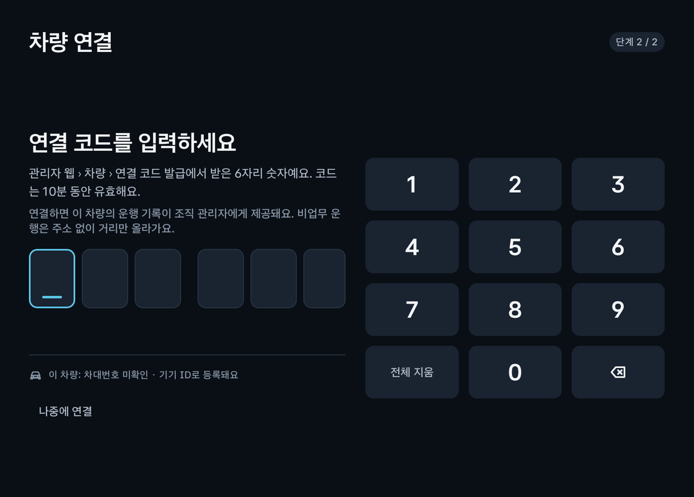

# 자동 운행기록부 (DriveLog)

AltroStudio · 현대자동차그룹 차량용 앱 개발 공모전 출품작 (Pleos Connect 앱)

**차가 알아서 쓰는 업무용 승용차 운행기록부.** 주행 중에는 조작할 것이 없고, 정차 후 한 번 눌러 용도만 고르면 월별 운행기록부가 완성됩니다.

| 첫 실행 동의 | 차량 연결 (6자리 코드) | 홈 |
|---|---|---|
|  |  |  |

> 개발 중입니다. 차량 앱(자동 운행 기록, 정차 후 분류, 월별 운행기록부, CSV, 디자인 v0.1), 서버(Supabase) 연결 코드·동기화, 관리자 웹(기업 계정·개발자 계정)을 만들었고, 에뮬레이터에서 실서버 연결·동기화까지 확인했습니다. 기능별 상태는 [docs/status.md](docs/status.md)에 있습니다.

## 바로가기

| 항목 | 위치 |
|---|---|
| release APK | [`apk/AltroStudio_DriveLog_release.apk`](apk/AltroStudio_DriveLog_release.apk) |
| 관리자 웹 | https://altrostudio-drivelog.vercel.app |
| 구현 현황 | [docs/status.md](docs/status.md) |
| 기획 요약 (심사 항목별) | [docs/plan-summary.md](docs/plan-summary.md) |
| Pleos SDK 활용 | [docs/sdk-usage.md](docs/sdk-usage.md) |
| 시연 시나리오 | [docs/demo-script.md](docs/demo-script.md) |
| 사업성 | [docs/business.md](docs/business.md) |
| 기록 무결성 (해시 체인) | [docs/integrity.md](docs/integrity.md) |

## 핵심 기능

- **자동 기록**: 기어가 P를 벗어나면 운행 시작, P에서 끝. 주행 전·후 계기판 거리를 Pleos Vehicle SDK에서 직접 읽어 넣습니다.
- **주행 중 조작 0**: 주행 중에는 터치할 요소가 없는 화면만 보입니다. 정차하면 용도를 고르는 화면이 뜹니다.
- **원탭 분류**: 출퇴근 / 일반업무 / 비업무. 같은 목적지는 지난번 분류를 먼저 제안하고, 비업무 운행은 주소를 지우고 거리만 남깁니다.
- **국세청 서식 월별 운행기록부와 CSV**: 업무사용비율까지 자동 계산하고, Excel에서 바로 열리는 CSV로 내보냅니다.
- **고칠 수 없는 기록**: 차량별 해시 체인과 수정 이력으로 기록이 바뀐 흔적을 찾아냅니다.
- **회사 연결**: 관리자 웹에서 받은 6자리 코드를 정차 중 한 번 입력하면 조직에 등록되고, 기록은 오프라인 우선으로 올라갑니다. 서버 없이도 차량 안에서 모든 기능이 동작합니다.
- **관리자 웹**: 기업 계정은 차량 연결 코드 발급과 모든 차량의 월별 운행기록부·CSV, 개발자 계정은 기업 정보 등록과 기업 관리자 계정 만들기.

## 저장소 구조

| 폴더 | 내용 |
|---|---|
| `app/` | 차량 앱 (Kotlin, Jetpack Compose, Room, WorkManager) |
| `web/` | 관리자 웹 (HTML·CSS·JavaScript, 설치할 패키지 없음) |
| `backend/` | Supabase 스키마·권한(RLS)·함수, 시연용 데모 데이터 |
| `docs/` | 구현 현황, SDK 활용, 시연 시나리오, 사업성, 무결성, 라이선스 |
| `design/` | 디자인 기준 (토큰, 화면 명세, 목업) |
| `apk/` | release 서명 APK |
| `claude_chat/` | 개발 과정의 AI 협업 기록과 인수인계 문서 |

## 빠르게 해 보기 (심사용)

1. `Pleos_Connect_v2.1` 에뮬레이터를 **Cold boot**로 켜고 [`apk/AltroStudio_DriveLog_release.apk`](apk/AltroStudio_DriveLog_release.apk)를 설치합니다 (`adb install apk/AltroStudio_DriveLog_release.apk`).
2. 앱을 열고 동의합니다. **계정이나 로그인 없이** 바로 기록이 켜집니다.
3. 연결 화면에서 시연용 코드 `422511`을 넣으면 데모 조직에 연결되고, [나중에 연결]을 누르면 이 차량 안에서만 기록합니다.
4. Virtual Console에서 기어를 **D**로 바꾸고 계기판 거리를 늘린 뒤 **P**로 바꾸면 분류 화면이 뜹니다. 용도를 한 번 누르면 월별 운행기록부에 들어갑니다.
5. 새로 만든 AVD는 시간대가 한국이 아니라서 운행 시각이 다르게 보일 수 있습니다. 한국 시간으로 보려면 `adb shell service call alarm 3 s16 Asia/Seoul`을 실행합니다.

시연 흐름은 [docs/demo-script.md](docs/demo-script.md), 사용한 Pleos SDK는 [docs/sdk-usage.md](docs/sdk-usage.md)에 있습니다.

## 앱 이름과 한 줄 소개

- **앱 이름**: 자동 운행기록부 (영문명 DriveLog, 임시)
- **한 줄 소개**: 외근이 잦은 법인·개인사업자를 위해 차가 알아서 운행기록부를 써 주는 앱. 주행 중에는 조작이 없고, 정차 후 한 번 눌러 용도만 고르면 월별 운행기록부가 완성됩니다.

## 실행 방법

1. Android Studio에서 `File > Open`으로 이 저장소 루트를 엽니다.
2. Gradle 동기화가 끝나면 실행 대상으로 `Pleos_Connect_v2.1` 에뮬레이터를 고르고 **Run** 합니다.

명령줄로 빌드·설치할 때 (JDK 17):

```bash
./gradlew assembleDebug      # app/build/outputs/apk/debug/app-debug.apk
./gradlew installDebug       # 실행 중인 에뮬레이터에 설치
```

서버 주소와 공개 키는 `local.properties`에 넣습니다 (`local.properties.example` 참고, 커밋 금지). 비워 두면 앱은 서버 없이 이 차량에만 기록합니다.

### 관리자 웹 (`web/`)

배포 주소: **https://altrostudio-drivelog.vercel.app** (Vercel)

이 PC에서 띄울 때는 Node.js 18 이상이 필요하고, 설치할 패키지는 없습니다.

```bash
node web/scripts/write-config.mjs   # local.properties의 서버 주소·공개 키로 web/js/config.js를 만든다
node web/scripts/serve.mjs          # http://127.0.0.1:5173
```

자세한 내용은 [web/README.md](web/README.md)에 있습니다.

## 테스트 환경과 필요한 설정

| 항목 | 버전 / 값 |
|---|---|
| JDK | 17 |
| Gradle / AGP / Kotlin | 8.10.2 / 8.8.2 / 2.0.0 |
| compileSdk / targetSdk / minSdk | 35 / 35 / 28 |
| 에뮬레이터 | Pleos Connect v2.1 (Android 14, API 34, x86_64, Automotive) |

### Pleos Connect 에뮬레이터

1. `Tools > SDK Manager > SDK Update Sites`에 아래 URL을 추가하고, `SDK Platforms`에서 API 34의 Pleos Connect system image를 설치합니다.
   - Windows/Linux: `https://nexus-playground.pleos.ai/repository/raw-releases/connect-avd/2.x/crp-sys-img.xml`
2. `Device Manager > Create device > Automotive > Pleos Connect v2.1.0`
3. Advanced Settings: Boot **Cold**, RAM **4 GB**. Quick boot로 실행하면 차량 데이터(VHAL)를 쓸 수 없습니다.
4. 에뮬레이터는 Google Play 서비스(GMS)가 없는 이미지입니다.
5. 부팅 직후 Wi-Fi가 연결된 것처럼 보여도 인터넷이 안 되는 경우가 있었습니다. 이때 Wi-Fi를 껐다 켜면 연결됩니다.
   ```bash
   adb shell cmd wifi set-wifi-enabled disabled
   adb shell cmd wifi set-wifi-enabled enabled
   ```

### Virtual Console (차량 상태 시뮬레이션)

```bash
adb forward tcp:8088 tcp:8088
```

브라우저에서 http://127.0.0.1:8088/ 에 접속합니다.

### 데모 계정

| 용도 | 값 |
|---|---|
| 관리자 웹 · 기업 계정 | https://altrostudio-drivelog.vercel.app · 아이디 `demo@altro.com` (데모 기업의 운행기록부, 차량 연결 코드) |
| 관리자 웹 · 개발자 계정 | 아이디 `AltroStudio@altro.com` (팀 운영용: 기업 등록과 기업 관리자 계정 만들기, 운행 기록은 볼 수 없음. 심사용으로는 제공하지 않습니다) |
| 비밀번호 | 저장소에 두지 않습니다. 기업 계정 비밀번호는 기획서(접수양식)에 적어 제출합니다 |
| 차량 연결 코드 (시연용, 여러 번 사용 가능, 2027-02-28까지) | `422511` |

데모 조직과 계정은 `backend/seed/`에서만 만들고, APK에는 들어가지 않습니다.

## APK 위치

- [`apk/AltroStudio_DriveLog_release.apk`](apk/AltroStudio_DriveLog_release.apk) (release 서명 빌드, 약 26 MB)
- 직접 만들 때: `keystore.properties.example`을 `keystore.properties`로 복사해 서명 키 정보를 넣고 `./gradlew assembleRelease` (서명 키와 `keystore.properties`는 커밋하지 않습니다)
- APK에는 서버 주소와 **공개 키(Publishable key)** 가 들어 있습니다. 공개 키는 앱에 넣도록 만들어진 키이고, 데이터 보호는 서버의 권한 규칙(RLS)이 맡습니다. 관리용 secret/service_role 키는 APK와 웹 어디에도 넣지 않습니다.

## 개발자 메모

- 에뮬레이터 화면만 녹화하기 (한 번에 최대 3분):
  ```bash
  adb shell screenrecord --time-limit 180 /sdcard/drivelog-demo.mp4
  adb pull /sdcard/drivelog-demo.mp4
  ```
- 에뮬레이터 시간대를 한국으로: `adb shell service call alarm 3 s16 Asia/Seoul`
- 데모 조직·관리자·연결 코드: `backend/seed/` (값은 커밋하지 않는 `backend/.env`)

## 라이선스

- 이 저장소의 코드: [MIT](LICENSE)
- 사용한 오픈소스와 라이선스: [docs/licenses.md](docs/licenses.md) (Pleos Connect SDK, AndroidX·Jetpack Compose, OkHttp·Okio, Kotlin·kotlinx 등 Apache License 2.0, 글꼴 Asta Sans는 SIL Open Font License 1.1). 앱 안에서는 **설정 › 오픈소스 라이선스**에 같은 내용이 있습니다.
- 관리자 웹(`web/`)은 외부 JavaScript 라이브러리를 쓰지 않고, 글꼴 Asta Sans만 Google Fonts에서 불러옵니다.
- 현대자동차그룹·Pleos의 로고와 상표는 쓰지 않습니다.
